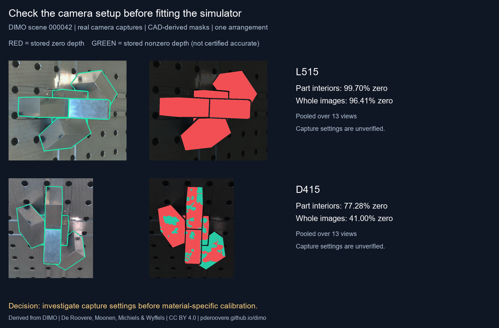

# Robotic bin-picking capture audit

An experimental Python tool for checking RGB-D capture validity on reflective
industrial parts. The repository contains an executed audit of public DIMO
captures and a generic customer-capture CLI. It is an engineering prototype,
not a validated perception product or a paid customer service.

## Start here: run the generic CLI demo

From the repository root, install the generic audit requirements and generate
three explicitly synthetic depth frames, color images and masks:

```powershell
python -m venv .venv
.\.venv\Scripts\python.exe -m pip install -r requirements-customer.txt
.\.venv\Scripts\python.exe -m unittest discover -s customer_audit/tests -v
.\.venv\Scripts\python.exe -m customer_audit.demo --output work\customer_demo
.\.venv\Scripts\python.exe -m customer_audit --manifest work\customer_demo\manifest.json --output work\customer_report
```

Open `work/customer_report/report.md` and `metrics.json`. This small artificial
example demonstrates the CLI contract; it is not a sensor simulation or real
robotics evidence. See [customer manifest format](customer_audit/README.md).

## Real public-data experiment

On DIMO scene 000042, we audited 13 views of the same five-block arrangement
from two cameras:

| Camera | Stored zeros inside CAD-derived part regions | Stored zeros across images |
|---|---:|---:|
| RealSense L515 | 99.70% | 96.41% |
| RealSense D415 | 77.28% | 41.00% |



The L515 result has a major caveat. Twelve images share a minimum positive raw
depth value of 1960. If the saved scale is 0.25 mm/unit, that boundary is 490 mm,
consistent with the device minimum-range filter. The sample omits the actual
depth scale and capture settings, so this remains a hypothesis. **Do not use
99.70% as a metallic-material dropout parameter.**

Both cameras observe the same published world-pose labels; their camera
configurations differ. The comparison does not isolate sensor hardware or
surface material. Nonzero depth is counted as present, not as accurate.

See [capture diagnosis](experiments/dimo/reference_results/CAPTURE_DIAGNOSIS.md)
and [experiment README](experiments/dimo/README.md).

## Reproduce the DIMO experiment

Python 3.11 or newer. The original image and CAD archives are **not committed**.
From `experiments/dimo`, create a venv, install `requirements.txt`, and run:

```powershell
python -m venv .venv
.\.venv\Scripts\python.exe -m pip install -r requirements.txt
.\.venv\Scripts\python.exe -m unittest discover -s . -p "test_*.py" -v
.\.venv\Scripts\python.exe download_sample.py --cache data
.\.venv\Scripts\python.exe download_d415_sample.py --data data
.\.venv\Scripts\python.exe audit_depth.py --data data --output rerun_results
.\.venv\Scripts\python.exe diagnose_captures.py --data data --output rerun_diagnosis
```

Downloads are limited to selected scenes; source URLs and SHA256 values are
stored locally in provenance JSON. DIMO is CC BY 4.0; see [NOTICE](NOTICE.md).

## Separate Isaac Sim source

`experimental/isaac/` contains procedural asset and synthetic-data generation
source, plus 50 generated example assets. Its asset generation is CPU-side. The
Isaac Sim renderer and harness physics **have not run on a compatible GPU**.
The earlier workstation has an RTX 2050 laptop GPU with 4 GB VRAM. See its
[build status](experimental/isaac/BUILD_STATUS.md) and
[Isaac setup notes](experimental/isaac/README.md). Do not treat it as verified
Sim2Real evidence.

## Commercial status

No customer data, deployment, improved pick success or revenue is represented
here. A proposed first paid experiment is an input-gated, one-part RGB-D audit;
any initial price is only a willingness-to-pay test, not market research.
Prospect lists and tailored outreach stay outside this public repository.

## License

Project source uses MIT; third-party attribution for derived DIMO material is
listed in [NOTICE.md](NOTICE.md). The DIMO image in this repository is derived
under CC BY 4.0 and must retain attribution.
