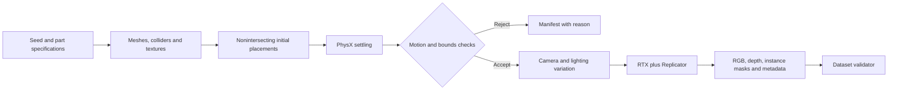

# Technical blueprint: reflective parts first, harness dynamics separately

The common infrastructure is asset authoring, camera rendering and labels. The
hard parts differ: metal primarily needs calibrated appearance and sensor
reconstruction; harnesses additionally need calibrated mechanics and topology.
Putting both in one simulator does not solve either transfer problem.

## 1. Pin the stack and the first task

| Component | Selection | Why |
|---|---|---|
| Runtime | CPython 3.12, Isaac Sim 6.1.0.0 | Explicit environment; no legacy World dependency |
| Dynamics | PhysX CPU, TGS, 240 Hz starting point | Compound rigid colliders, D6 joints, straightforward USD writeback |
| Rendering | RTX Real-Time; optional RTX Path Tracing | Fast iteration and a separately sampled reflection reference |
| Scene representation | OpenUSD and schemas supplied with Isaac | Geometry, materials, cameras and physics in one inspectable stage |
| Capture | Bundled `omni.replicator.core` | RGB, optical-axis depth, instance segmentation |
| Arrays/images | Isaac's NumPy; Pillow 12.3.0 | Typed NPY depth/masks; PNG RGB |
| Assets | Python standard library; custom polygonal mesher | No paid models or mesh download dependency |
| Optional preview | NumPy 2.2.6, Matplotlib 3.10.1, separate environment | CPU inspection of the exact generated geometry |
| RL for this MVP | None | Rendering labeled images does not require a reward or policy |
| Later policy training | Isaac Lab 3.0.0rc1 + RSL-RL PPO, separate locked environment | Only after adding a real robot/gripper task definition |

The current Isaac Lab installation documentation provides the 3.0.0rc1 package
and supports an Isaac Sim 6.1 integration. Use its documented environment and
lock the resolved dependencies when that work starts; do not install another RL
dependency tree into this SDG environment.
[Isaac Lab installation](https://isaac-sim.github.io/IsaacLab/develop/source/setup/installation/index.html),
[RL libraries](https://github.com/isaac-sim/IsaacLab/blob/develop/docs/source/concepts/reinforcement_learning.rst).

First task: segment visible metal parts and identify their geometric family.
The current assets represent shape families, not customer part numbers. A
customer-specific pose estimator needs the customer's exact CAD and identity
labels. Rotationally symmetric parts also require symmetry-aware pose metrics.

## 2. Asset creation

1. Sample dimensions and material density with a fixed seed. The sample has 50
   distinct shapes, not 50 identical meshes with different colors.
2. Construct a radial cross-section and revolve/extrude it into a closed hollow
   triangle mesh. Flanges use a stepped profile. Gears use straight-sided teeth;
   they are not involute engineering CAD.
3. Tile each annular layer with convex wedges. A single hull would seal the
   bore. Do not use a dynamic triangle-mesh collider as an unexplained substitute.
4. Check edge incidence, outward orientation, positive signed volume and convex
   collider planes. Compare summed collider volume to visual volume. The supplied
   CPU tests exercise these properties for all 50 parts.
5. Set mass to mesh volume times density times a small uncertainty factor. Do
   not assign independently arbitrary mass and geometry.
6. Generate directional roughness textures, author face-varying UV coordinates
   and connect the texture's scalar channel to shader roughness in linear color
   space. These are roughness scratches, not actual grooves or normal maps.
7. Store source parameters and assets alongside every generated dataset. Retain
   units, seeds, generator revision and any external asset license information.

No external models are required. Optional workshop HDR lighting can be obtained
from [Poly Haven's HDRI library](https://polyhaven.com/hdris); the assets use
[CC0](https://polyhaven.com/license). The supplied runner uses procedural area
lights and a dome, so it works without downloading an HDRI. A downloadable CAD
file elsewhere is not automatically an asset you may redistribute. Customer CAD
or your own geometry is the practical route for exact industrial parts.

The next geometry upgrades should be driven by real failures: edge chamfers,
blind holes, burrs, cast surfaces and fixtures. Smooth shading alone does not
create the silhouette or contact geometry of a chamfer. Use measured dimensions
and preserve the distinction between render meshes and collider approximations.

## 3. Scene and simulation execution

Use one physics root per metal object, with visual mesh and multiple collider
children. Apply mass on the root. The floor and four walls are separate static
boxes. All stage units are meters, kilograms and seconds.

Initial placements use separated envelopes and layered drops. Nothing is
teleported into an overlapping final pile. This starter distribution is orderly;
it does not cover realistic feeder drops, human reloading, or severe tangles.
Sequential insertion from measured loading trajectories is the next pile-model
upgrade. The harness bin is larger than the metal bin to accommodate its footprint.

The runner initializes physics after construction, steps without rendering,
and checks body poses every approximately 50 ms. Acceptance requires less than
2 mm/s translation and 0.05 rad/s rotation for 0.5 s after at least 1.5 s of
simulation. It also checks finite poses, body-origin escapes and an actual
gravity drop. These thresholds are initial engineering choices.

The checks do **not** certify absence of mesh penetration, cable crossings or
bad contact forces. A body-origin bounds test is weaker than a full mesh-bounds
test. Add contact/penetration and cable-centerline distance checks before
calling a harness dataset physically validated. Failed scenes retain a manifest;
do not silently include them as valid training examples.

The implementation uses manual `SimulationManager.step` and explicit Replicator
capture at zero time increment. Pausing image capture avoids motion between
labels. Keep CPU physics writeback enabled when reading poses from USD.
[NVIDIA SDG workflow](https://docs.isaacsim.omniverse.nvidia.com/6.1.0/replicator_tutorials/tutorial_replicator_sdg_workflows.html),
[Simulation Manager API](https://docs.isaacsim.omniverse.nvidia.com/6.1.0/py/source/extensions/isaacsim.core.simulation_manager/docs/index.html).

Raw USD focal length and aperture use tenths of a stage unit. With a meter
stage, a 20 mm focal length must be authored as 0.20, not 20. The runner handles
this conversion and records the physical values in millimeters. Getting both
aperture and focal length wrong by the same factor can hide the error because
the field of view stays unchanged.
[OpenUSD camera units](https://openusd.org/release/api/class_usd_geom_camera.html).

## 4. Domain randomization: concrete starting parameters

These are uncalibrated priors implemented in the source, not ranges proven to
improve transfer. Change them when measurements contradict them.

| Variable | Implemented starting range | What must constrain it later |
|---|---|---|
| Metal outer radius | 16–28 mm, flange 1.15–1.35 times larger | CAD and actual SKU distribution |
| Bore radius / height | 5–10 mm / 14–28 mm | CAD tolerance and manufacturing variation |
| Density | 2,700 or 7,850 kg/m³ | Known alloy; do not mistake appearance for density |
| Mass uncertainty | Volume × density × 0.95–1.05 | Scale measurements and machining voids |
| Dynamic metal friction | 0.15–0.45 | Tilt/slide tests for the exact pair and oil state |
| Static metal friction | Dynamic + 0.05–0.20 | Breakaway threshold; must be ≥ dynamic |
| Restitution, metal | 0–0.10 | Measured drop/impact behavior |
| Metallic / base roughness | 0.95–1.0 / 0.06–0.35 | Controlled highlights and surface finish |
| Texture | Directional roughness scratches; different seed per part | Surface orientation, wear, scratch scale |
| Orientation, metal | Uniform quaternion samples | Actual feeder/loading distribution |
| Lighting | Three rectangle lights, randomized position/size; 3,500–6,500 K | Factory lamp geometry and spectral/exposure behavior |
| Light intensity | Panels 1,200–4,500; dome 70–250 in authored USD units | Calibrated exposure and illumination; not a lux claim |
| Camera | 640×480; focal length 19–24 mm, aperture 36 mm | Actual focal length, sensor size, pose and lens model |
| Harness cable radius | 1.8–2.8 mm | Measured bundle diameter, not wire conductor diameter |
| Harness link length/count | 14–18 mm; 8–12 stem links + six branch links | Convergence versus curvature/contact resolution |
| Cable mass per length | 0.06–0.12 kg/m | Weigh a measured cable length |
| Connector mass | 8–20 g each | Scale/CAD; connector geometry matters too |
| Bend/twist joint stiffness | 0.003–0.012 / 0.001–0.005 N·m/rad | Sag, bending and twist experiments |
| Angular joint damping | 0.00003–0.00009 N·m·s/rad | Free-decay tests, not solver-stability tuning alone |
| Harness dynamic friction | 0.30–0.70 | Jacket–jacket, jacket–bin, connector–bin measurements |
| Optional depth augmentation | σ = 0.001 × z² meters; 2% random dropout | An actual sensor residual/invalid-pixel model |

Sample correlated conditions together. Oily metal should not have an unrelated
friction distribution and a perfectly dry appearance. Lock a physical SKU's
geometry during appearance sweeps. Re-randomizing camera calibration broadly
can harm a model intended for one fixed calibrated cell.

Not implemented yet: distortion, rolling shutter, exposure/saturation model,
motion blur, specularity-dependent depth failures, projector/stereo decoding,
oil-film BRDFs, anisotropic machining marks and deformable insulation contact.
Adding Gaussian noise to ideal depth does not implement these phenomena.

## 5. Harness-specific physics constraints

The supplied Y harness uses regular rigid bodies, not an articulation tree:
capsule links, a taped junction hub, and fixed connectors. D6 joints lock three
translations and drive the three rotations. Joint X follows the cable tangent;
Y/Z bending drives share coefficients. Angular spring/damper coefficients supplied
in N·m/rad are converted to USD's degree-based units before authoring.
[D6 joints](https://docs.omniverse.nvidia.com/kit/docs/omni_physics/107.3/dev_guide/rigid_bodies_articulations/joints.html),
[drive units](https://nvidia-omniverse.github.io/PhysX/ovphysx/latest/population/PhysicsDriveAPI.html).

Adjacent capsules have intentionally overlapping endcaps and pairwise collision
filtering. Nonadjacent collisions remain enabled. Branch attachment points are
separated on the hub; putting sibling capsules at one point causes immediate
overlap forces. Linear CCD requires both scene and body flags and does not
guarantee against fast rotational cable crossings.

This model omits conductor sliding, insulation compression, twist–bend coupling,
plastic set, tape hysteresis and measured finite-rotation constitutive behavior.
Use it initially for visible cable/connector perception, not extraction-force
or untangling-success labels. When reducing segment length, adjust stiffness
consistently: a simple rod approximation has per-joint bend stiffness EI/L.
Changing discretization with unchanged coefficients changes the modeled cable.

If cable mechanics becomes the main product, evaluate the official
[MuJoCo elasticity cable plugin](https://github.com/google-deepmind/mujoco/blob/main/plugin/elasticity/README.md)
in a separate calibration branch. Its elastic-modulus parameters are not
interchangeable with the D6 coefficients. It also needs validation; switching
engines is not a shortcut to correct entanglement mechanics.

## 6. Make the output useful for training

1. Execute the one-part smoke run. Visually inspect RGB, depth and object masks.
   Check an easily measured camera-to-flat-surface distance and a known pixel
   projection before trusting depth units or camera conventions.
2. Qualify 50 metal parts and compare 240/480 Hz physics results. Inspect bore
   contacts, ejected parts, collider seam jitter and resting pose distributions.
3. Verify each mask maps to the intended object root, including multi-mesh
   parts and multi-body harnesses. Save camera intrinsics and extrinsics for
   every image; do not use metadata from the previous camera view.
4. Create independent scene seeds and hold out entire shapes, scenes and real
   recording sessions. Several views of one pile must stay in one split.
5. Train a small supervised segmentation baseline. Compare real-only versus
   synthetic-pretrained then real-finetuned with the same held-out real images
   and matched training budgets. Report per-condition failure rates, not only
   an aggregate synthetic validation score.
6. Obtain a small real validation set from the intended sensor/cell. For
   reflective depth, measure missing-depth rate, false returns, edge artifacts
   and residuals as a function of angle, distance, illumination and finish.
   Without real data, transfer remains unmeasured.
7. Expand only the failure families that the real evaluation identifies. Track
   dataset/source hashes, engine versions, hardware, seeds and calibration files.

At present the useful result is a reproducible asset/scene/capture foundation.
It does not include a trained perception model, a pick-success evaluator or a
robot controller. Selling its unvalidated output as sensor-accurate edge cases
would make a stronger claim than the engineering supports.

## 7. RL only after a grasp task exists

Add one robot, one gripper and one bounded task first. A minimal action space can
be Cartesian end-effector increments and gripper opening under an existing
controller. Define reset states, observations, collision/force limits, episode
termination and success as an object lifted clear and held for a defined time.
Ground-truth object state may be privileged training information, but evaluation
must use the sensor observations available on the actual robot.

Use RSL-RL PPO through a compatible, pinned Isaac Lab environment when this task
exists. Measure success over held-out initial states and hardware trials. The
current generator has no Gymnasium step/reset contract, reward or policy and
should not be described as an RL environment. Learning to exploit a cable model's
crossings or friction artifacts is not progress toward real untangling.
